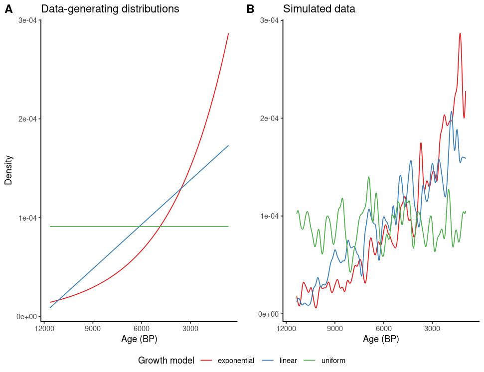
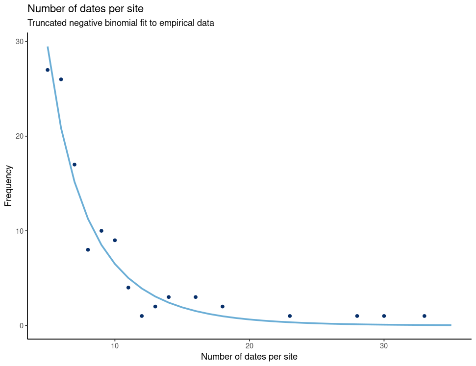

# Supplementary Information

The Supplementary Methods give the detail needed to reproduce the analyses, followed by supporting simulation figures and a likelihood-sensitivity note.

## Supplementary Methods

### S1. AustArch data analysis

#### S1.1 Study context and empirical reference set

Our aim was to quantify how deliberate or inadvertent decisions about the within-site temporal distribution of radiocarbon dates distort regional “dates-as-data” inference. We used AustArch [@williams2014AustArchDatabase14C], a continental-scale compilation for Sahul, to parameterise realistic site structures. The published database release reports 5,044 radiocarbon determinations from 1,748 sites. The archived source extract used here contains 5,288 age records, of which 4,828 are labelled radiocarbon determinations from 1,704 named sites. To reduce long-term taphonomic contrast while retaining a large regional dataset, we constrained the analysis to Holocene data through three phases of selection.

1. Initial screening. We retained radiocarbon determinations (both conventional and AMS) with reported ages and one-sigma errors; records flagged as erroneous or unrelated to human activity were removed. Ages were initially restricted to 500-20,000 $^{14}$C yr BP so that all possible Holocene observations lay within the SHCal20 or Marine20 calibration ranges [@heaton2020Marine20TheMarineRadiocarbon; @hogg2020SHCal20SouthernHemisphere; @ramsey2024DevelopmentINTCALDatabase; @reimer2020INTCAL20NorthernHemisphere].

2. Material and context filtering. To reduce laboratory and reservoir idiosyncrasies we accepted charcoal/wood, human bone collagen, and well-attested freshwater or marine shells from clearly anthropogenic contexts (e.g., rock shelters, middens, hearths, earth mounds). Ambiguous contexts and “unusable” designations were excluded.

3. Holocene restriction and site eligibility. Dates were first calibrated, and records were retained when their posterior grids overlapped the Holocene analysis window, 11,650-651 cal BP; the upper bound avoids near-modern boundary effects. SPD summaries and likelihood calculations were evaluated over that window, while FD and KDE summaries used weighted-mean calibrated ages that fell inside it. We kept only sites contributing five or more valid Holocene determinations, yielding a final reference set of 976 determinations from 116 sites (median 7 dates per site; range 5-33). This threshold excludes sparsely dated sites from the empirical baseline because they do not contain enough within-site chronological information to benchmark what a sampling rule has removed. Their consequences are instead assessed experimentally by down-sampling the better-dated sites into sparse-site analogues, including random-1, random-5, oldest, youngest, and bracketed scenarios. Weighted-mean calibrated ages were computed for descriptive plots only; all inference used the full calibrated posteriors.

Production analyses were run under R 4.5.3 [@rcoreteam2025LanguageEnvironmentStatistical], using the tidyverse for data handling and rcarbon [@crema2021InferenceLargeSets] for calibration. Production simulations and empirical Monte Carlo sampling used seed 1234, as did the bootstrap post-processing.

#### S1.2 Baseline demographic curves

The curated AustArch set defines an “all-dates” baseline (Fig. 1) for comparison with sub-sampling scenarios (Fig. 2). We constructed three familiar summaries on a common 100-yr calendar grid:

1. Summed probability distribution (SPD). Calibrated posterior grids were summed and then smoothed with a 100-yr running mean.

2. Frequency distribution (FD). Simple counts in 100-yr bins were computed using each date’s weighted-mean calibrated age.

3. Kernel density estimate (KDE). A Gaussian KDE (bandwidth 100 yr) was centred on each weighted-mean calibrated age.

Each curve was normalised to unit area; for joint display the SPD and KDE were re-binned to the FD grid to avoid visual aliasing. These curves provide descriptive context only and do not enter the likelihood-based inference.

#### S1.3 Within-site sub-sampling experiments

To mimic field and budget constraints, we imposed five within-site rules on the AustArch reference set: i) random-1: one random determination per treated site; ii) random-5: five random determinations per treated site (see Fig. 2); iii) oldest: the determination with the greatest conventional radiocarbon age; iv) youngest: the determination with the least conventional radiocarbon age; v) bracketed: that oldest-youngest pair.

Each rule was applied at two intensities: 50% of sites treated (with the remainder contributing all dates) or 100% treated; the all-dates baseline (Fig. 1) is equivalent to 0% in this framing. We ran 1,000 Monte Carlo realisations for the random rules and for the 50% site-subset draws. The full-site oldest, youngest, and bracketed rules are deterministic and therefore yield one curve apiece.

A single realisation comprised: i) sampling the treated sites (if intensity < 100%); ii) selecting date indices within treated sites according to the rule; iii) appending all dates from untreated sites; iv) calibrating determinations with SHCal20 (terrestrial) or Marine20 (shells), without regional marine offsets or site-specific $\Delta R$ corrections; and v) computing SPD, FD, and KDE curves and re-normalising to unit area. Where a scenario had repeated realisations, we calculated the mean and 2.5th/97.5th percentiles at each calendar bin. Figures plot these summaries against the all-dates baseline; deterministic full-site rules are shown as single curves.

These empirical experiments are used diagnostically to show how within-site rules deform regional aggregates, rather than as demographic reconstructions.

### S2. Simulation study

#### S2.1 Sample-size and age-error models based on empirical data

We parameterised the simulations from the cleaned and filtered AustArch dataset (section S1.1), so that each synthetic dataset had 116 sites and the same broad date-count and measurement-error structure as the empirical reference set. We fitted a truncated negative binomial distribution (minimum 5 dates per site) to the site-level sample sizes to reproduce variation in dating intensity among sites. We also regressed logged standard errors against radiocarbon ages to model how measurement uncertainty varies with sample age.

#### S2.2 Growth models, synthetic-data generation, and sampling strategies

For the Holocene-restricted date range (11650-651 cal BP), we defined three population growth models as unit normalised, truncated probability densities: constant (uniform), linearly increasing, and exponentially increasing. Unit normalisation completely determines the uniform density, and it constrains the truncated linear and exponential distributions to one-parameter models which can be uniquely characterised by specifying the proportionate increase in population over the restricted date range.

We generated each synthetic radiocarbon dataset under one of the three growth models. For the linear and exponential models, we specified a 10-fold increase towards the present, approximating the cumulative Holocene growth inferred for Sahul by @johnson2011ReconstructingDynamicsAncient. We drew site sample sizes from the negative-binomial model and true calendar ages from the chosen growth distribution. We then converted those calendar ages to conventional radiocarbon ages with SHCal20, simulated standard errors from the age-error model, and recalibrated the determinations with rcarbon. This sequence retained calibration uncertainty while keeping the generating calendar ages inside the analysis window.

We evaluated seven sampling strategies across three levels of bias intensity (50%, 75%, or 100% of sites): all dates (using every available radiocarbon determination); random-1, random-3, and random-5 (selecting dates randomly without replacement from each site); oldest and youngest (selecting the greatest and least median calibrated age, respectively); and bracketed (selecting both extremes). Sites not selected for the biased sampling strategy (i.e., at the 50% and 75% intensities) contributed all their dates.

#### S2.3 Likelihood calculation, model fitting and model selection

Rather than using smoothed representations of the data such as kernel densities or regressions that do not respect unit normalisation, we fitted the normalised population growth distributions directly to the calibrated dates. Given the distributional nature of the calibrated dates, we considered two possible definitions for the pointwise log-likelihood $\ell_i$:

$$
\ell_i^1 = \log \int f(x \mid \theta)\, p_i(x)\, dx
$$

and

$$
\ell_i^2 = \int \log\!\bigl(f(x \mid \theta)\bigr)\, p_i(x)\, dx
$$

where $f(x \mid \theta)$ is the probability density of the growth model, $p_i(x)$ is the posterior probability density of the calibrated age, and $\theta$ is the distributional parameter to be estimated. In practice, $p_i(x)$ is represented on a discrete calendar grid and the integrals are finite sums. The $\ell^1$ definition is the marginal likelihood used in direct population modelling by @timpson2021DirectlyModellingPopulation. The $\ell^2$ definition is the posterior expectation of the model log density and is included here as a sensitivity score. Under this study's discretisation it resembles an SPD-weighted grid calculation, but it does not fit a model to a smoothed aggregate SPD.

We fitted all models by maximum likelihood estimation under each likelihood definition. We then computed the Akaike Information Criterion ($\mathrm{AIC} = -2\ell + 2k$), where $\ell = \sum_{i=1}^N \ell_i$ is the total log likelihood and $k$ is the number of estimated parameters [@akaike1974NewLookStatistical]. The minimum-AIC model was used for the model-recovery analysis. To distinguish a nominal winner from clear model support, we also used a parsimony rule motivated by one-standard-error selection [cf. @yates2021ParsimoniousModelSelection]. For each model $m$, we calculated its total $\Delta\mathrm{AIC}_m$ from the minimum-AIC model and estimated the standard error of this total as $s_m\sqrt{N}$, where $s_m$ is the standard deviation of the $N$ pointwise AIC differences. Models satisfying $\Delta\mathrm{AIC}_m \leq s_m\sqrt{N}$ were treated as similarly supported, and only those with the smallest parameter dimension in that set were retained. Linear and exponential models have equal dimension, so both could remain when they were not distinguishable. @timpson2021DirectlyModellingPopulation instead use BIC for comparison; the shared point is that the population model is evaluated against the calibrated determinations rather than against a plotted SPD.

#### S2.4 Simulation design and performance evaluation

We generated 1,000 simulated datasets for each of the three population models (uniform, linear, exponential). Applying seven sampling strategies at three intensities produced 63,000 strategy-intensity dataset combinations, including the repeated all-dates reference. Common random numbers paired replicate $i$ across all model-intensity scenarios; consequently, the all-dates result for a generating model was identical at 50%, 75%, and 100%. For every combination, we fitted all three candidate models under both likelihood definitions and applied both minimum-AIC and one-standard-error-style selection.

We evaluated sampling strategy performance using three metrics: i) *accuracy*, the proportion of simulations in which minimum AIC identified the generating population model; ii) *parameter bias*, the difference between fitted and generating parameters for the linear and exponential models; and iii) *unambiguous support*, the proportion of replicates in which the parsimony rule retained only the generating family. Each estimate pooled the three generating models equally ($n = 3{,}000$). Accuracy and unambiguous support used 1,000 paired cluster-bootstrap resamples of replicate identifiers for their 95% intervals; all three generating-family outcomes remained together within each resampled cluster. Parameter-bias summaries report the mean and central 95% of replicate-level biases. Ambiguous replicates were reduced to one Boolean outcome before aggregation, so retaining two models could not give a replicate extra weight.

### S3. Reproducibility

The de-identified review archive is organised for use outside GitHub. Its fast verification path restores the pinned `renv` environment, runs the test suite, and executes the default `{targets}` workflow against the included input data. It also supplies the nine validated production RDS files, runtime metadata, and a script that rebuilds Figures 3-5 without rerunning the expensive simulations. The complete deterministic runner, atomic checkpoint path, and R 4.5.3 Docker recipe are included for an optional full rerun on a multicore Linux host. The private-for-review repository link and reserved DOI will be inserted in the main-text Data accessibility statement after the final package lock.

## Supplementary Figures

### Data-generating distributions

{#fig-si-s1 width=95%}

**Supplementary Figure S1.** Data-generating distributions and example simulated data used in the simulation study. Panel A shows the three unit-normalised growth models over the Holocene analysis window: uniform, linear, and exponential. Panel B shows example simulated radiocarbon-date distributions generated from those models after applying the empirical site-count, per-site sample-size, and age-error structure used in the simulations.

### Empirical dates-per-site model

{#fig-si-s2 width=75%}

**Supplementary Figure S2.** Empirical and fitted distribution of radiocarbon determinations per eligible AustArch site. Points show the observed number of dates per site after Holocene filtering; the line shows the truncated negative-binomial model used to generate per-site sample sizes in the simulation study. The full horizontal range is retained to show the long right tail of heavily dated sites.

### Likelihood-sensitivity check

The main manuscript reports the simulation results for the $\ell^1$ likelihood because it is the direct marginal likelihood used in related population modelling and gave the same qualitative conclusions as $\ell^2$. The $\ell^2$ runs were used as a sensitivity check for the accuracy, parameter-bias, and unambiguous-support results shown in the main-text simulation figures. Both definitions recovered the same broad ranking: all-dates and span-preserving random-*n* strategies performed best; oldest, youngest, and random-1 strategies performed worst; and the bracketed rule was intermediate.

## References

